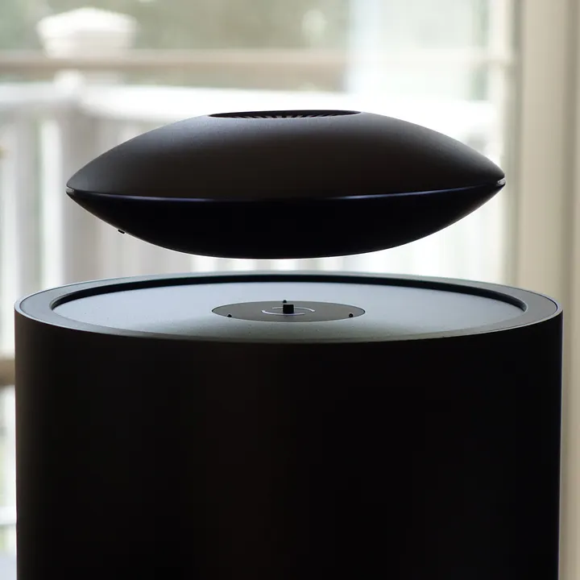

<p align="right"><a href="README.md">English</a> | 简体中文</p>

# Mars Control for iOS


让 Mars 再次听你指挥。

为 Mars by crazybaby 磁悬浮蓝牙音箱编写的非官方 iOS 开源控制 App，使用 SwiftUI 和 CoreBluetooth，直接通过本地蓝牙控制音箱，无需账户或云服务。这是独立重建的兼容实现，并非官方 iOS App 源码。



## 关于 Mars

Mars 把飞碟形全频扬声器悬浮在圆柱形低音基座上，将蓝牙音乐、磁悬浮和环形灯光结合在一起。飞碟也可以离开基座播放音乐，放回基座充电。想了解这款音箱，可以阅读 Paul Teich 为 TIRIAS Research 撰写的 [Mars By Crazybaby Is Bluetooth Audio Magnetism](https://medium.com/@TIRIAS_Research/mars-by-crazybaby-is-bluetooth-audio-magnetism-467e7ad891e)。

当旧版控制 App 无法获取时，这个项目提供一个可以自行构建、维护和改进的 iPhone 控制器。

## 支持与验证

以下验证来自一台 Mars 音箱与一台 iPhone 的实际使用，不代表所有硬件或固件版本均已覆盖。

| 功能 | 当前支持 | 已完成的验证 |
| --- | --- | --- |
| 蓝牙连接 | 扫描、连接、断开、记住设备 | 已在 iPhone 上建立 BLE 控制连接并收取设备响应 |
| 读取设备状态 | 悬浮、灯效、亮度、音量、EQ | 已读取音箱返回的状态 |
| 悬浮控制 | 升起、降落；按钮与上下拖动操作 | 已实际观察到飞碟下降与重新升起 |
| 灯效切换 | 4 个模式入口（0–3） | 已完成模式切换、回读及肉眼观察；未逐一命名所有效果 |
| 灯光亮度 | 0–15 调节与百分比显示 | 已回读设置值，实际观察到最暗及亮度变化 |
| 音量调节 | 0–16 范围，读取当前档位 | 已写入低音量并回读；恢复值在重连后读回确认。未逐档测量响度 |
| EQ 预设 | CrazyEQ、低音、室内、户外，以及旧版预设 4 | 已完成 2 → 0 → 2 切换与状态回读；未逐一试听全部预设 |
| 设备改名 | 最多 17 个 UTF-8 字节；重启后人工核对 | 已成功更改名称，重启后由使用者确认；自动名称回读存在截断限制 |

深色界面包含设备列表、功能详情、连接状态、操作反馈及播放帮助。断开连接或操作进行中会禁用设置控件；设置超时不会自动重复发送。

上述“实物验证”针对控制能力。拖动手势等界面交互并未全部完成自动化测试。EQ 的自定义频段编辑尚未实现。

## 0.5.0 新增：实验性距离感应音量

Auto Volume 根据 Android 2.1.0 的完整实现重建：约每两秒向音箱查询 RSSI（`0x17`），每三个采样计算一次音量。已检查的 Android 3.0.11 Java 代码保留页面名与请求枚举，但没有找到完整自动控制路径。

1. 进入“自动音量”，开始只读信号检测。拿着 iPhone 走近、走远，观察音箱返回的信号。
2. 收到至少三个有效采样和有效非零音量后，设置音量上限，再手动开启。三个采样仅验证返回格式，并不证明距离判断准确。
3. 保持 App 在前台。手动操作设备、断线、超时、无效响应、设置回读不一致或离开前台都会停止；不会自动恢复，也不会自动取消静音。

采用音箱返回的有符号信号字节，不使用 iPhone 自身的 BLE RSSI 替代。仅接受预期的两字节响应，第二字节必须在 −110 至 −10 dBm 的合理范围；不返回该响应的设备无法开启。

原算法外增加 1–15 档上限、每次最多升高一档和逐步降低；降低上限时可能需要更大的降幅。检测开始时，上限不高于已读设备音量或第 8 档。无需云服务、麦克风、位置权限或持续后台运行。手机位置只是听者位置的近似，不能保证感知响度恒定。

协议与算法检查通过，尚未在 Mars 实物上验证。停止后已发送的指令仍可能完成，请先低音量测试。

## 0.4.0 新增：实验性控制

依据 Android 3.0.11 的控制行为重建。以下新增内容已通过本地协议检查与编译，尚未在 Mars 实物上验证：

- 设备信息：读取两字节 MCU 版本，不提供固件升级。
- 提示音：分别控制开关机与起飞提示音；修改一个开关时保留另一个状态。必须读到有效当前状态，且 MCU 第二段大于 25，才允许写入。
- 待机：明确发送待机/唤醒指令，进入待机前有确认提示。这不是自动休眠定时器。待机可能断开蓝牙；只有控制连接仍可用时才能尝试 App 唤醒，否则需按音箱电源键。
- 连接列表：只读查看当前连接和历史设备名称，单类最多读取 16 项。不发送断开、移除或切换音源指令。
- EQ 正式名称：CrazyEQ（0）、低音（1）、室内（2）、户外（3）；保留旧版预设 4，不提供自定义频段编辑。

进入“提示音与待机”或“连接设备”，先点击读取按钮。不支持或没有返回有效状态时，高级设置保持不可用。原版的版本条件仅用于兼容性限制，并不证明本机支持。刷新连接列表会清空旧记录，不完整结果会显示返回总数与读取错误。

本版不包含 RGB 调色、Wi-Fi 组网，以及其他型号的节能控制。

## 使用

1. 开启 Mars 飞碟。需要升降时，给基座接通电源，并正确放置飞碟。
2. 在 App 中进入设备页面，允许蓝牙权限并等待连接。
3. 选择悬浮、灯光、声音或名称设置。
4. 播放音乐时，在 iPhone 系统蓝牙设置中连接 Mars，并使用你喜欢的音乐 App。音乐音频连接与本 App 的 BLE 控制连接分别工作。

改名后重启飞碟，在系统蓝牙设置核对名称，再回 App 确认。BLE 广播名称可能仍保持原名称。

## 构建

需要支持 iOS 17 或更新系统的 Xcode、iPhone 和 Apple 开发签名。蓝牙硬件功能需要真机。

```sh
git clone https://github.com/faintbear/crazybaby-mars-ios.git
cd crazybaby-mars-ios
cp Local.xcconfig.example Local.xcconfig
open MarsControl.xcodeproj
```

在 `Local.xcconfig` 填写自己的 `DEVELOPMENT_TEAM` 和唯一的 `MARS_BUNDLE_ID`，在 Xcode 选择 iPhone 后运行。也可以在 Xcode 的 Signing & Capabilities 中设置个人团队。个人签名的有效期与安装限制由 Apple 决定。

已包含 Xcode 工程，无需安装第三方运行依赖。如修改工程结构，可用 [XcodeGen](https://github.com/yonaskolb/XcodeGen) 重新生成：

```sh
xcodegen generate --spec project.yml
```

## 范围

目前专注单台 Mars 的主要控制功能。不提供固件升级、Double Up 双机组对或 Multipoint 连接管理，也不内置音乐播放器。连接信息只读；距离感应音量为实验功能。

截至整理本项目时，使用 Crazybaby、Mars、Swift 和 Objective-C 等关键词检索，未找到可直接使用的 Mars iOS 开源控制器；这不构成对所有公开或历史项目的穷尽判断。

## 许可证与致谢

项目代码使用 [MIT License](LICENSE)。Crazybaby、Mars 名称与商标归其权利人所有，项目与原厂没有隶属关系。

产品照片由项目发起者提供用于介绍音箱，图片权利归原权利人所有，不包含在代码的 MIT 授权范围内。产品背景阅读材料署名见上方 TIRIAS Research 文章链接。

图标为独立绘制的社区版本：以薄荷绿开口圆环与悬浮圆点呼应音箱，并使用 UNOFFICIAL 标识区别于官方 App。
